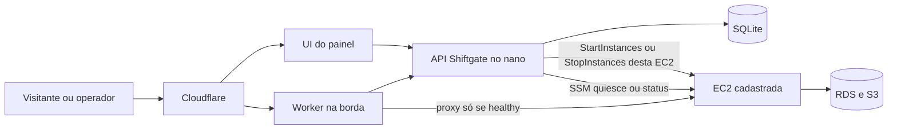
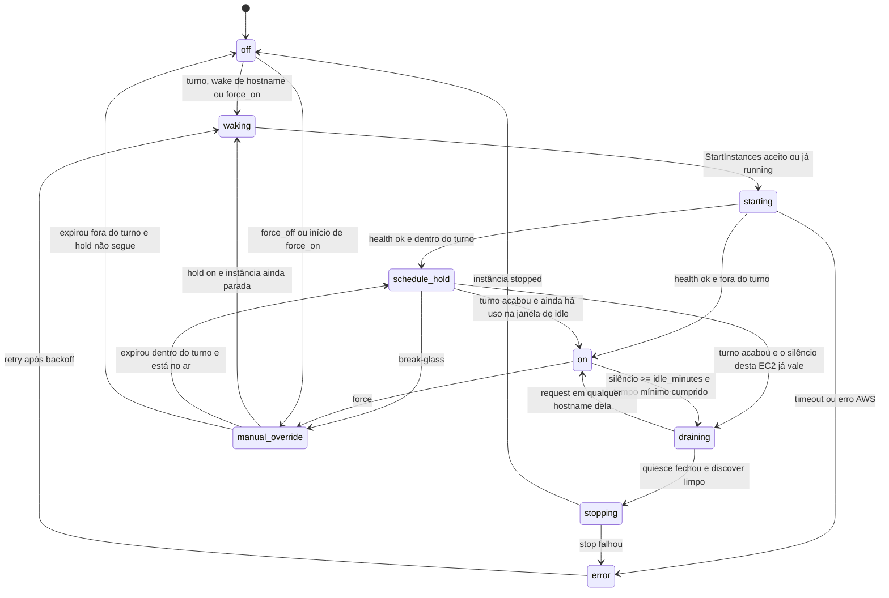

# Playbook — Shiftgate

Documento-fonte para abrir um repositório em branco e construir o painel que pilota as EC2 da raiz `Documents\MM`. Este arquivo não é a aplicação. O repositório sugerido chama-se `shiftgate`. Não criar o git neste passo. Não alterar o código das aplicações.

Canvas da arquitetura: `canvases/shiftgate-painel-ec2.canvas.tsx` no projeto Cursor deste workspace.

Leitura feita em 19/10/2026 na pasta `c:\Users\Caio Mendes\Documents\MM\`, em README, `package.json`, compose, nginx, units systemd, scripts de deploy e docs. Nada foi consultado ao vivo na conta AWS. Onde o texto diz "comprovado", o arquivo está no disco. Onde diz "hipótese", o arquivo não sustenta a frase.

O operador conta cerca de onze instâncias em operação e pode passar os IPs. Essa contagem é conferência dele, não um teto e não uma lista no código. O disco comprova um instance id e vários endereços. O describe, na hora do cadastro, junta ou separa.

## 1. Veredito

A unidade do relógio é a **EC2**. Cada instância é um registro no painel, com identidade (instance id, região, nome, se tem Elastic IP, hostnames que apontam para ela), turno próprio e política própria de desligar de novo. O turno é o conjunto de dias e horários em `America/Sao_Paulo` em que **essa** instância fica sempre ligada. A política de desligar é o número de minutos de silêncio de uso **dessa** EC2, fora do turno, até `StopInstances`. Override manual com expiração, quando existe, é da mesma EC2.

O hostname continua sendo a porta de entrada. A borda resolve o `Host` para a EC2 cadastrada e aplica o turno e o idle **dessa** linha. Outra EC2 não herda turno nem timeout. Instância nova é registro novo: zero mudança de código, zero lista das onze.

Fora do turno daquela EC2, o padrão é instância desligada, com wake pelo acesso. O visitante vê a página Ligando, o controle faz um `StartInstances` daquela instância, espera o health do hostname pedido e libera o login. Teto de 180 s. No turno, a automação não desliga essa EC2.

Várias aplicações na mesma EC2 compartilham o turno e o relógio de desligar, porque a decisão é por instance id. Parar processo e deixar a instância `running` não é o objetivo da política. SSM pode quiescer os workloads conhecidos antes do stop; o que o operador opera no cadastro é a EC2. `StopInstances` sai só para aquela instância. Serviço desconhecido no host bloqueia o stop. A política é fail closed.

O Shiftgate mora numa `t4g.nano` separada e não entra em nenhum repositório da raiz MM. Auth forte, auditoria, cooldown, override com expiração, health antes de proxiar, um start por vez, fuso `America/Sao_Paulo` e a primeira semana só em observação continuam valendo.

## 2. O que a raiz mostrou

A raiz `Documents\MM` tem oito pastas: `AppSheet`, `AppsScripts`, `ERP V1`, `ERP V2`, `Explosões insumos`, `Financiamento`, `Outros APPs`, `QUERYS`. `Outros APPs` concentra os repositórios com `.git`.

Há **um** instance id em todo esse disco: `i-0af76df96c4e714b6`, no `backend/deploy/ec2.ps1` do ERP V2, região `us-east-2`, usuário `ec2-user`, endereço `18.117.69.26`. O `erp.sh` diz que esse Elastic IP permanece associado no `poweroff`. Nessa instância o repo prova Nginx (systemd) e o PM2 `erp-v2-backend` em `/var/www/erp-v2-backend`, health `http://127.0.0.1:3333/health`, `server_name backend.mundomoveis.tech`. Não prova outra aplicação no mesmo instance id.

Os outros deploys trazem **outros endereços**, sem instance id:

| Endereço no arquivo | Onde | O que o arquivo afirma |
| --- | --- | --- |
| `18.117.69.26` | ERP V2 `ec2.ps1` / `erp.sh` | EIP que permanece; instância `i-0af76df96c4e714b6` |
| `3.19.149.106` | dashboard `ec2_deploy_runbook.md` | `EC2_PUBLIC_IP` preenchido; usuário `ubuntu` |
| `18.225.52.232` | ops-line `deploy-ec2.ps1` e `deploy/ec2/README.md` | host padrão do deploy; DNS citado na HostGator |
| `3.138.192.206` | deadline-manager README e `remote_deploy.ps1` | IPv4 público da API Hermes na porta 8000; o backlog pede EIP porque o IPv4 muda |
| `3.19.20.146` | commerce-bridge `deploy/staging/README.md` | o texto chama de Host/EIP; path `/opt/commerce-bridge` |

Cinco endereços diferentes não viram cinco instâncias vivas só por estarem escritos. Também não viram a mesma instância. IP público sem EIP muda, e arquivo velho mente. O describe, na hora do cadastro, é quem junta ou separa. Até lá o seed guarda cada endereço como EC2 candidata, sem colar ninguém em `i-0af76df96c4e714b6`.

Dois hosts multi-aplicação estão comprovados **por caminho e unit**, ainda sem instance id. No cadastro eles viram **uma** EC2 cada, com um turno e um idle, e os hostnames dessa instância na mesma ficha:

- **fluxo-scripts.** Units `fluxo-scripts` (`/opt/fluxo-scripts`, porta 8787), `fluxo-ppw-api` (127.0.0.1:8001) e `fluxo-ppw-web` (porta 3000). O mesmo nginx `fluxo-scripts.mundomoveis.tech` encaminha `/` para 8787 e `/ppw` para 3000. O comentário da unit fala em caixa de ~1 GB. Usuário `ubuntu`.
- **commerce-bridge staging.** Compose na mesma EC2: backend :8000, worker sem HTTP, frontend Next :3000, nginx no hostname `commercebridge-staging.mundomoveis.tech`. RDS MySQL fora da instância. O README de staging descreve isso como o ambiente no ar, no endereço da tabela acima.

n8n, Metabase e Evolution aparecem como nomes em docs de segurança (ERP V2, commerce-bridge, fluxo-capas). Não há repositório, compose, unit, porta, hostname nem instance id deles nesta raiz. O frontend do ERP V2 aponta `NEXT_PUBLIC_BASE_URL` para `https://backend.mundomoveis.tech/` e não tem script de deploy na EC2. O menu cita `https://mundomoveis-distribuidor.vercel.app/`; isso é um link, não o host do frontend.

A semente completa, com a coluna de prova, está na seção 19. Ela não é a lista das onze. O operador ainda confere quantas instâncias existem, qual IP aponta para qual instance id, e quais hostnames caem em cada uma.

## 3. Decisões

1. **EC2 é o registro que o operador opera.** Criar, editar turno, editar minutos de idle, editar hostnames, desativar. Sem teto de 11 e sem lista compilada de instance ids. A borda e o reconciliador leem a tabela.
2. **Plano de controle na `t4g.nano`**, Amazon Linux, systemd, um processo Node, SQLite no disco dela. Custo de lista perto de US$ 3/mês. Ela não é instalada em nenhuma instância semeada pela raiz MM e não entra no cadastro de turno. Tag `shiftgate:role=control-plane`, sem `allow-stop`.
3. **Borda no Cloudflare Worker.** O código do Worker não contém hostnames nem instance ids. O `Host` do pedido é a chave: a API acha a EC2 e devolve Ligando ou autoriza o `fetch` da origem. Hostname novo é linha no cadastro, não deploy. A hora de boot não fica presa num request HTTP. A rota DNS na Cloudflare é configuração da borda, não código do painel.
4. **ALB descartado como borda.** Um Application Load Balancer na casa de US$ 16/mês come a economia de uma `t3.medium` e continua caro diante de várias instâncias.
5. **Lambda descartada como cérebro do MVP.** Poll de health, lock e relógio ficam no processo que já está ligado.
6. **SQLite, não um segundo RDS.** Backup é cópia do arquivo.
7. **A política desliga a EC2.** `StartInstances` / `StopInstances` são o caminho, nas condições da seção 5. SSM `start|stop|status` é passo interno: `status` alimenta o discover; `stop` dos workloads conhecidos pode quiescer antes do `StopInstances`; `start` sobe o que o boot não trouxe para o health passar. O documento SSM aceita `action` em `start|stop|status` e `slug`. O mapeamento slug → `systemctl` / `pm2` / `docker compose` mora em `/etc/shiftgate/apps/<slug>.env` no disco da instância. A API não envia shell livre. O operador não cadastra turno de processo.
8. **Discover antes de qualquer `StopInstances`.** O `status` lista units, processos PM2 e containers. O que não está no cadastro de workloads nem na allowlist de infra (nginx, Caddy, `amazon-ssm-agent`, ssh, chrony, cron, o daemon Docker) marca a EC2 `block_instance_stop`. O Shiftgate não mata o desconhecido e não para a instância.
9. **Acordar a EC2 sobe os hostnames dela.** Não há turno por aplicação para deixar irmã de fora. Nginx (ou Caddy) permanece enable: é infra. Se uma unit conhecida não sobe com o boot, o reconciliador manda SSM `start` nela para o health do hostname passar. Isso é passo do wake, não uma agenda separada.
10. **Idle e turno são da EC2.** CPU da instância não desliga ninguém. No máximo, um dia, um veto de CloudWatch adia o stop. Default: veto desligado. O sinal de silêncio é request de usuário em qualquer hostname daquela EC2.
11. **Fuso `America/Sao_Paulo` via IANA.** O código não grava `UTC-3` fixo.
12. **Feriados ficam no schema e fora do MVP.** Calendário vazio significa "só dia da semana + hora".
13. **Primeira semana `automation=observe` em cada EC2.** O painel mostra o que faria. Não chama `StartInstances`, `StopInstances` nem SSM de mutação. `status` de discover é leitura e pode rodar nessa semana.
14. **O seed local não é aplicado sozinho.** A UI oferece "importar semente"; um admin confirma instance id, região, EIP, hostnames e tags depois do describe. Importar não cria a décima segunda linha por mágica, nem impede a primeira que o disco não citou: criar registro é a mesma tela.

## 4. Topologia



Cada hostname (exemplos comprovados: `backend.mundomoveis.tech`, `fluxo-scripts.mundomoveis.tech`, `capas.mundomoveis.tech`, `dem.mundomoveis.tech`, `commercebridge-staging.mundomoveis.tech`, `dashboard.mundomoveis.tech`, `api.mundomoveis.tech`) passa a ser resolvido pelo Worker. A origem é o endereço estável da EC2 dona daquele hostname, usado pelo Worker só quando a fase dessa EC2 permite proxy.

O painel tem outro hostname (exemplo: `shiftgate.mundomoveis.tech`), atrás de Cloudflare Access. Fala só com a API do nano.

Com a instância `stopped`, o endereço não aceita conexão. O Worker responde Ligando sem precisar dessa conexão.

### Dois tempos de Ligando

O fluxo fora do turno é um só: página Ligando, um start daquela EC2, health, até 180 s, login. O que muda é se a instância já está no ar.

| Situação observada | O que a API faz | O que a página diz | Teto |
| --- | --- | --- | --- |
| Fora do turno, instância `stopped` | um `StartInstances` dessa EC2, espera `running` e SSM online, health do hostname pedido | "Ligando" | 180 s |
| Fora do turno, instância já `running` (wake anterior ainda no idle, ou override) | sem segundo `StartInstances`; health do hostname; SSM `start` só se o boot não trouxe o workload | "Ligando" enquanto o health não passa | dentro dos 180 s |
| No turno, ou já healthy | proxy | — | — |

A resposta do `admit` leva `wait_kind`: `instance` quando houve ou ainda há boot, `health` quando a instância já está no ar e só o health falta, mais `deadline_at`.

### Boot quando a instância estava parada

`StartInstances` dessa EC2 → sistema sobe → SSM online → health do hostname que o visitante pediu. Os outros hostnames da mesma EC2 passam a ter a instância de pé; cada um libera o próprio visitante quando o health **dele** responde. Health de um hostname não é turno de outro. Se o health não passar na janela, a fase da EC2 vai a `error` e o visitante vê a página de falha. Não há segundo `StartInstances` enquanto o lock e a fase disserem que o start está em curso.

### TLS

Vários hostnames comprovados terminam TLS na própria instância (Let's Encrypt via nginx ou, no vortex, Caddy). Com a instância parada, HTTP-01 não renova. Antes do wake em produção: DNS-01 no Cloudflare, ou renovação dentro do turno, com alarme 14 dias antes do vencimento. O Worker termina TLS com o visitante; Worker → origem usa o certificado da instância quando ela está de pé.

O ops-line documenta DNS na HostGator para `api.mundomoveis.tech`. Esse hostname só entra no wake depois que o Worker estiver na frente. Até lá o cadastro da EC2 pode existir e a fase 2 não publica nesse hostname.

## 5. Política da EC2

Há um relógio por instance id. Hostname entra na resolução. Workload entra no discover e no quiesce. Nenhum dos dois tem turno nem minutos de idle.

### No turno

`now` em `America/Sao_Paulo` cai numa janela dessa EC2: a automação não chama `StopInstances` nela. Se o power observado é `stopped`, o tick pede um `StartInstances` para a instância ficar ligada na janela. Pedido de acesso no meio do boot entra na espera do mesmo start.

### Fora do turno

O padrão é desligada. Acesso a um hostname dela, em rota da allowlist, abre Ligando e segue a seção 7. Uso recente segura a instância até cumprir os `idle_minutes` **dela**. Silêncio cumprido, discover limpo e demais guards: `StopInstances` só dessa EC2.

Outra EC2, no mesmo minuto, segue o turno e o idle do próprio registro. Tráfego no ERP não zera o relógio do fluxo, e o fim do turno do fluxo não desliga o ERP.

### Vários hostnames, uma decisão

fluxo-scripts, se o describe confirmar uma instância, tem um turno e um número de minutos. `fluxo-scripts.mundomoveis.tech` é a porta. As units do painel, do ppw e da API compartilham esse relógio. Request em qualquer hostname cadastrado nessa EC2 conta como uso dela.

Worker sem HTTP (scheduler do Hermes, worker do commerce-bridge, timers do bom-sync) também não tem turno próprio. Mora na EC2 e obedece o turno dela. Agenda noturna é janela dessa EC2, não uma segunda política.

### Quando `StopInstances` sai

Sai somente quando **todas** as condições valem para **aquela** EC2:

1. Fora de toda janela de turno dela, ou override `hold=off` vigente.
2. `idle_minutes` de silêncio de uso dela cumpridos, e `min_runtime_sec` desde o último health ok também cumprido.
3. Fase não está em `schedule_hold`, `waking`, `starting`, `stopping`.
4. Nenhum override ativo com `hold=on`.
5. `block_instance_stop` está limpo (discover sem serviço desconhecido).
6. Passou `quiesce_sec` (default 60 s) com a decisão ainda válida. Nesse intervalo o SSM pode pedir stop dos workloads conhecidos. O fim do intervalo é `StopInstances`, não "processo parado e instância no ar".
7. `instance_stop_enabled` está ligado. Default **desligado** até um admin ver o discover limpo e autorizar.
8. A EC2 está ativa (`deactivated_at` nulo).
9. Relógio com skew ≤ 30 s. Sem isso, ninguém para.
10. O instance id não é o do plano de controle.
11. `automation=enforce`. Em `observe`, grava o evento e não chama a AWS.

`StartInstances` sai quando essa EC2 precisa ficar de pé (entrou no turno, wake de um hostname dela, override hold on, start manual) e o power observado é `stopped`. Um lock por EC2. O segundo hostname que chega no meio do boot espera. Não há segundo `StartInstances`.

O botão "parar instância" existe para o admin, com o slug da EC2 redigitado e motivo. Dentro do turno, sem override `hold=off`, a API devolve `in_shift` e não chama a AWS. Com serviço desconhecido, devolve `unregistered_service`.

Desativar o registro **não** chama `StopInstances`. Tira a EC2 da automação e do wake. Reativar devolve o registro ao tick. A instância fica como a AWS a deixou até a política voltar a valer.

### O que conta como infra, e o que bloqueia

Allowlist default de infra, por EC2, editável: `nginx`, `caddy`, `amazon-ssm-agent`, `sshd`, `chronyd`, `crond`, `snapd`, o daemon `docker` / `containerd`. Eles podem estar ativos. Não bloqueiam o stop e não são desligados como workload.

Bloqueia: unit systemd fora da allowlist e fora dos workloads cadastrados; processo PM2 sem slug; container Docker sem slug. O bom-sync avisa, no README de deploy, que o timer do pipeline principal de BOM **não** é instalado por aquele pacote porque já existe automação na EC2. Esse é o tipo de vizinho que o discover tem de achar antes de qualquer `StopInstances`.

### Tags da EC2

| Tag | Valor |
| --- | --- |
| `shiftgate:managed` | `true` |
| `shiftgate:allow-stop` | `true` |
| `shiftgate:role` | `workload` |
| `shiftgate:host` | slug da EC2, igual ao cadastro |

Não há tag de turno por aplicação. O slug do workload vive no SQLite e em `/etc/shiftgate/apps/<slug>.env`.

No nano: `shiftgate:role=control-plane`, sem `allow-stop`.

## 6. Máquina de estados

A fase que o operador lê é a da EC2. O power é o que o describe viu. Workload não tem fase.

### Fase da EC2

| Fase | Significado |
| --- | --- |
| `off` | Instância parada. Fora do turno, sem override, sem wake em curso |
| `waking` | Precisa ligar: turno, wake ou override. Lock pego, `StartInstances` ainda não confirmado |
| `starting` | `StartInstances` em curso, ou instância no ar com health do hostname ainda pendente |
| `schedule_hold` | No ar, dentro do turno. A automação não desliga esta EC2 |
| `on` | No ar fora do turno: wake, uso dentro da janela de idle, ou sobra do fim do turno |
| `draining` | Silêncio desta EC2 já cumprido. Quiesce em curso. Request em qualquer hostname dela cancela |
| `stopping` | `StopInstances` pedido |
| `manual_override` | Operador forçou `hold=on` ou `hold=off` até `expires_at` |
| `error` | Observado diverge ou a chamada falhou. Automação congelada até backoff ou ação humana |

EC2 com `deactivated_at` preenchido não muda de fase por tick nem por wake. A borda responde `closed`.

### Power observado

| Power | Significado |
| --- | --- |
| `stopped` | Instância parada. Compute dessa VM zerado |
| `starting` | `StartInstances` em curso ou SSM ainda offline |
| `running` | Instância no ar. A fatura de compute corre |
| `stopping` | `StopInstances` em curso |
| `blocked` | `running` com `block_instance_stop`. A política queria parar; o discover segurou |
| `error` | Start/stop da instância falhou ou estourou o teto |



Discover sujo não empurra a fase para `off`. O power continua `running`, `block_instance_stop=1`, e o painel mostra o motivo.

### Guards

- Nada automático tira a EC2 de `schedule_hold` para `draining` enquanto `now` em `America/Sao_Paulo` cai numa janela dela.
- `manual_override` com `hold=on` vence o fim do turno até `expires_at`.
- `manual_override` com `hold=off` vence o turno até `expires_at`. A UI pede o slug da EC2 digitado, motivo com pelo menos 12 caracteres e a duração. O alarme "devia estar no turno e está parada" dispara mesmo assim, com o id do override.
- Wake é ignorado em override hold off, em registro desativado, em `error` dentro do cooldown, e em `stopping`.
- O reconciliador não mexe na instância do plano de controle.
- Skew acima de 30 s bloqueia o tick de turno e qualquer `StopInstances`. O `admit` de um visitante ainda pode acordar, porque esse caminho é acesso, não relógio.

### Tempos default (por EC2, sobrescrevíveis)

O campo que o operador edita no dia a dia é `idle_minutes`. O resto tem default e cabe na ficha.

| Parâmetro | Default | Função |
| --- | --- | --- |
| `start_timeout_sec` | 180 | Teto de Ligando quando inclui boot |
| `health_interval_sec` | 5 | Poll de health e da página |
| `min_runtime_sec` | 900 | Depois de ficar saudável, o idle não desliga antes disso |
| `min_off_sec` | 120 | Depois de `off`, um start automático seguinte espera, para não oscilar. O visitante na allowlist ainda passa pelo `admit`, dentro do orçamento de 3 starts por hora |
| `idle_minutes` | 20 | Silêncio de uso desta EC2, fora do turno, até armar o stop |
| `quiesce_sec` | 60 | Janela de SSM nos workloads conhecidos antes de `StopInstances` |
| `error_backoff_sec` | 60, depois 180, depois 600 | Três falhas; a quarta deixa `error` até um humano |
| `flap_limit` | 3 ciclos start/stop em 30 min | Cai em `error` e alarme |

`StopInstances` e `StartInstances` são idempotentes do lado AWS se o estado já é o pedido. O Shiftgate não chama de novo enquanto o lock e a fase disserem que a operação está em curso.

### Lock

Uma linha por EC2. Quem pega grava `owner`, `acquired_at`, `expires_at` (60 s, renovado no meio de `starting`/`stopping`). Insert condicional. Lock vencido pode ser roubado por um único update `WHERE expires_at < now`. Sem o lock, `off` → `waking` não acontece e `StartInstances` / `StopInstances` não acontecem. Dois hostnames da mesma EC2 disputam o mesmo lock.

## 7. Wake-on-demand

O wake começa no hostname e termina na EC2 dona dele. A página, o start único, o health e o teto de 180 s permanecem. O relógio que depois desliga é o dessa EC2.

### Passos

1. O pedido chega no Worker com `Host` conhecido.
2. O Worker chama `POST /internal/gate/admit` no nano, header `X-Shiftgate-Edge`, corpo `host`, `method`, `path`, `request_id`. Timeout 2 s. Se o nano não responde, 503 "controle indisponível" e **não** tenta a origem.
3. O controle resolve o hostname para a EC2. Hostname ausente: `closed`. EC2 desativada: `closed`.
4. Fase `schedule_hold` ou `on`, health recente desse hostname (idade menor que 15 s): `proxy`.
5. Fase `waking` ou `starting`: `wait`, com `wait_kind` já gravado. Não chama AWS de novo.
6. Fora do turno, fase `off`, rota na allowlist, cooldown cumprido: pega o lock, grava `waking`, responde `wait` com `wait_kind=instance`.
7. Fase `off` e rota fora da allowlist: `closed`. Página de fora do expediente, sem start.
8. Override hold off, ou `error` em cooldown: `closed` ou `failed`, sem start.
9. No `wait`, HTML Ligando com poll em `GET /internal/gate/status` a cada 5 s e `Retry-After: 5`. O POST original não fica aberto.
10. Health ok do hostname pedido → `schedule_hold` se entrou no turno no meio do boot, senão `on`. O poll seguinte recebe `proxy`.
11. O browser repete o login. O Worker proxia com `Host`, `X-Forwarded-For`, `X-Forwarded-Proto`.
12. Estouro do teto: fase `error`, lock liberado, página "não foi possível ligar" com id de evento.

Dentro do turno a instância deve já estar ligada pelo tick. Se estiver parada, o mesmo `admit` usa o mesmo start único, para o visitante não ficar sem caminho.

### Fila

Um `StartInstances` por EC2 e N esperas na mesma fase, uma por visitante ou por hostname dela. Limite: 3 starts automáticos por EC2 por hora. O quarto `admit` devolve `closed` com `wake_budget`. Entrada de turno e botão manual não usam esse orçamento.

### O que não é wake

- `GET /health` da sonda do Shiftgate.
- `/.well-known/acme-challenge/`.
- Path fora de `wake_paths` daquele hostname.
- Tráfego em `schedule_hold`: proxy normal. Também não reinicia o relógio de idle, porque no turno o idle não desliga.

Allowlist inicial sugerida para o backend ERP: `POST /sessions`. Cada outro hostname ganha a sua lista no cadastro (login do dashboard, do fluxo, do commerce-bridge, do capas). Scanner e `GET /` não ligam nada. A allowlist é porta de entrada, não política de turno.

## 8. Sinal de "esfriou"

Sinal primário, **por EC2**: nenhum request de usuário admitido como proxy em qualquer hostname dela durante `idle_minutes`.

Conta como usuário: método e path que passaram pelo proxy e não estão em `idle_ignore_paths` daquele hostname (`/health`, `/internal/gate/`, favicon, estáticos da página Ligando).

Não conta: sonda do reconciliador, poll da página Ligando, health da Cloudflare.

CPU, load e rede não entram. Uso num hostname zera o relógio da EC2 inteira. Uso numa EC2 vizinha não entra na conta.

Confirmação do drain: zero proxies in-flight em todos os hostnames dela. Se o Worker não reportar, o drain espera o teto de `quiesce_sec` e segue para o stop se o discover estiver limpo.

O relógio só arma `StopInstances` fora do turno. No turno a EC2 fica em `schedule_hold` mesmo em silêncio total.

Job que continua depois da resposta HTTP (invoice e baixa do ERP) não aparece nesse sinal. Até existir sonda `busy` devolvida pelo agente, silêncio na borda mente. O operador alonga `idle_minutes` dessa EC2, cobre o trabalho com o turno dela, ou deixa `automation=observe`. Isso é campo dessa instância. A EC2 ao lado não herda a cautela nem os minutos.

Worker e timer sem request de usuário não resetam o idle. Fora da janela, o silêncio já está cumprido e a EC2 vai a `draining` no fim do turno. Quem precisa de noite fica com janela noturna no próprio registro.

## 9. Agendador de turnos

Janela é da EC2, em horário local.

```text
weekday: 1-7 (ISO, segunda=1)
start_local: 05:00
end_local: 18:00
timezone: America/Sao_Paulo
```

Várias janelas por EC2. Janela que cruza meia-noite é `start > end` no mesmo registro. Seg–sex 05:00–18:00 são cinco linhas, editáveis juntas na ficha.

Avaliação a cada 15 s, para cada EC2 ativa:

- `now` dentro de uma janela e fase `off` ou `error` já fora do backoff → `waking`, motivo `schedule`.
- `now` dentro e fase `on` → `schedule_hold`. O idle deixa de poder desligar.
- `now` fora e fase `schedule_hold` → `on` se ainda há uso dentro de `idle_minutes`; senão `draining`.
- `manual_override` não é reescrito pelo tick. Na expiração, o tick seguinte recalcula.
- EC2 desativada é pulada.

Relógio: NTP na nano. Skew acima de 30 s: o tick não desliga e abre alarme `clock_skew`.

Feriado: tabela `holidays`. Fora do MVP o avaliador trata calendário vazio como "não é feriado".

## 10. Modelo de dados

SQLite, WAL, `busy_timeout` 5000. Chaves texto (ULID). Horas em ISO-8601 com offset. Nenhum CHECK limita a quantidade de linhas.

`instances` é a ficha que o operador cria e edita. `hostnames` é a porta. `workloads` é o inventário de processo para discover e quiesce, sem turno e sem idle.

```sql
CREATE TABLE instances (
  id TEXT PRIMARY KEY,
  slug TEXT NOT NULL UNIQUE,
  display_name TEXT NOT NULL,
  aws_region TEXT NOT NULL,
  aws_instance_id TEXT NOT NULL UNIQUE,
  has_elastic_ip INTEGER NOT NULL,
  origin_host TEXT,
  power TEXT NOT NULL,
  phase TEXT NOT NULL,
  timezone TEXT NOT NULL DEFAULT 'America/Sao_Paulo',
  idle_minutes INTEGER NOT NULL,
  automation TEXT NOT NULL DEFAULT 'observe'
    CHECK (automation IN ('observe', 'enforce')),
  override_hold TEXT,
  block_instance_stop INTEGER NOT NULL DEFAULT 1,
  block_reason TEXT,
  instance_stop_enabled INTEGER NOT NULL DEFAULT 0,
  start_timeout_sec INTEGER NOT NULL DEFAULT 180,
  health_interval_sec INTEGER NOT NULL DEFAULT 5,
  min_runtime_sec INTEGER NOT NULL DEFAULT 900,
  min_off_sec INTEGER NOT NULL DEFAULT 120,
  quiesce_sec INTEGER NOT NULL DEFAULT 60,
  phase_changed_at TEXT NOT NULL,
  power_changed_at TEXT NOT NULL,
  healthy_at TEXT,
  last_user_request_at TEXT,
  became_healthy_at TEXT,
  last_off_at TEXT,
  last_discover_at TEXT,
  ssm_online_at TEXT,
  start_attempts INTEGER NOT NULL DEFAULT 0,
  flap_window_started_at TEXT,
  flap_count INTEGER NOT NULL DEFAULT 0,
  holiday_calendar_id TEXT,
  created_at TEXT NOT NULL,
  deactivated_at TEXT
);

CREATE TABLE hostnames (
  id TEXT PRIMARY KEY,
  instance_id TEXT NOT NULL REFERENCES instances(id),
  hostname TEXT NOT NULL UNIQUE,
  health_url TEXT NOT NULL,
  wake_paths_json TEXT NOT NULL,
  idle_ignore_paths_json TEXT NOT NULL,
  created_at TEXT NOT NULL
);

CREATE TABLE workloads (
  id TEXT PRIMARY KEY,
  instance_id TEXT NOT NULL REFERENCES instances(id),
  slug TEXT NOT NULL UNIQUE,
  display_name TEXT NOT NULL,
  runtime TEXT NOT NULL CHECK (runtime IN ('pm2', 'systemd', 'docker', 'node')),
  unit_name TEXT NOT NULL,
  port INTEGER,
  hostname_id TEXT REFERENCES hostnames(id),
  created_at TEXT NOT NULL
);

CREATE TABLE schedule_windows (
  id TEXT PRIMARY KEY,
  instance_id TEXT NOT NULL REFERENCES instances(id),
  weekday INTEGER NOT NULL CHECK (weekday BETWEEN 1 AND 7),
  start_local TEXT NOT NULL,
  end_local TEXT NOT NULL,
  include_holidays INTEGER NOT NULL DEFAULT 0
);

CREATE TABLE overrides (
  id TEXT PRIMARY KEY,
  instance_id TEXT NOT NULL REFERENCES instances(id),
  hold TEXT NOT NULL CHECK (hold IN ('on', 'off')),
  reason TEXT NOT NULL,
  actor_id TEXT NOT NULL,
  starts_at TEXT NOT NULL,
  expires_at TEXT NOT NULL,
  cleared_at TEXT
);

CREATE TABLE events (
  id TEXT PRIMARY KEY,
  instance_id TEXT,
  hostname TEXT,
  at TEXT NOT NULL,
  actor_type TEXT NOT NULL,
  actor_id TEXT NOT NULL,
  action TEXT NOT NULL,
  from_phase TEXT,
  to_phase TEXT,
  reason TEXT,
  idempotency_key TEXT,
  aws_request_id TEXT,
  detail_json TEXT
);

CREATE UNIQUE INDEX events_idem
  ON events(idempotency_key)
  WHERE idempotency_key IS NOT NULL;

CREATE TABLE instance_locks (
  instance_id TEXT PRIMARY KEY,
  owner TEXT NOT NULL,
  acquired_at TEXT NOT NULL,
  expires_at TEXT NOT NULL
);

CREATE TABLE operators (
  id TEXT PRIMARY KEY,
  subject TEXT NOT NULL UNIQUE,
  email TEXT NOT NULL,
  role TEXT NOT NULL CHECK (role IN ('admin', 'operator', 'auditor')),
  disabled_at TEXT
);

CREATE TABLE edge_reports (
  id TEXT PRIMARY KEY,
  instance_id TEXT NOT NULL,
  hostname TEXT NOT NULL,
  at TEXT NOT NULL,
  kind TEXT NOT NULL,
  request_id TEXT,
  path TEXT,
  method TEXT
);

CREATE TABLE holidays (
  calendar_id TEXT NOT NULL,
  day TEXT NOT NULL,
  name TEXT NOT NULL,
  PRIMARY KEY (calendar_id, day)
);
```

`events` é a auditoria. `edge_reports` é append-only, podado em 7 dias, sem body, cookie ou senha. O idle lê o `at` mais recente de proxy de usuário entre os hostnames daquela `instance_id`.

Fase inicial no cadastro: o describe confirma a tag. Se a instância está `running` e o health de algum hostname passa, a fase inicial é `on` ou `schedule_hold`, conforme o relógio. O cadastro não emite stop. `block_instance_stop` nasce 1 até o primeiro discover limpo. `deactivated_at` nasce nulo.

## 11. Contratos HTTP

Base da UI: `https://<painel>/api`. Cookie `HttpOnly`, `Secure`, `SameSite=Lax`. Mutação exige `Idempotency-Key` e `X-Shiftgate-Reason` quando desliga, desativa ou fura turno.

Base interna: `https://<nano>/internal`, fora do hostname do painel.

A UI que o operador usa é a ficha da EC2. Lista sem teto: nome, instance id, região, power, fase, resumo do turno, `idle_minutes`, EIP sim/não, ativa ou desativada. A ficha abre identidade, hostnames, janelas, minutos, override vigente, workloads conhecidos, último discover e eventos.

Erros:

```json
{ "error": { "code": "unregistered_service", "message": "Há serviço fora do cadastro nesta EC2. StopInstances não saiu.", "event_id": "01J..." } }
```

Códigos: `unauthenticated`, `forbidden`, `not_found`, `validation`, `conflict_phase`, `tag_mismatch`, `control_plane_protected`, `lock_held`, `idempotency_replay`, `cooldown`, `wake_budget`, `in_shift`, `unregistered_service`, `inactive`, `clock_skew`, `observe_only`.

### UI — CRUD da EC2

`GET /api/instances` — todas as fichas. Paginação por cursor é permitida quando a lista crescer. Proibido constante de máximo 11.

`GET /api/instances/:slug` — identidade, power, fase, turno, `idle_minutes`, hostnames, workloads, override, `block_instance_stop`, último discover (units desconhecidas, sem vazar env).

`POST /api/instances` — admin. Corpo: `display_name`, `slug`, `aws_region`, `aws_instance_id`, `has_elastic_ip`, `origin_host`, `idle_minutes`, `hostnames[]`, `schedules[]`. O describe tem de achar a instância com as tags. Não chama stop. Resposta 201 com a ficha.

`PATCH /api/instances/:slug` — admin. Nome, região, flag de EIP, `origin_host`. Trocar `aws_instance_id` exige describe de novo.

`PUT /api/instances/:slug/schedules` — admin. Substitui as janelas dessa EC2.

```json
{
  "timezone": "America/Sao_Paulo",
  "windows": [
    { "weekday": 1, "start_local": "05:00", "end_local": "18:00" }
  ]
}
```

`PUT /api/instances/:slug/idle`

```json
{ "idle_minutes": 20 }
```

`PUT /api/instances/:slug/hostnames` — admin. Substitui a lista. Cada item: `hostname`, `health_url`, `wake_paths`, `idle_ignore_paths`. Hostname repetido em outra EC2 → 409 `validation`.

`POST /api/instances/:slug/deactivate` — admin, motivo. Preenche `deactivated_at`. Não chama `StopInstances`.

`POST /api/instances/:slug/activate` — admin. Limpa `deactivated_at`. A fase seguinte fica a cargo do tick.

`POST /api/instances/:slug/start`

```json
{ "hold_minutes": 120, "reason": "hora extra da fábrica" }
```

`hold_minutes` opcional cria override hold on nessa EC2. A resposta 202 traz fase e power. Em `observe`, 409 `observe_only` e um evento do que teria sido feito.

`POST /api/instances/:slug/stop`

```json
{ "hold_minutes": 60, "reason": "janela de manutenção" }
```

Dentro de `schedule_hold`, `hold_minutes` é obrigatório (override hold off). Sem isso, 409 `in_shift`. O stop, quando a lista da seção 5 fecha, é `StopInstances` dessa EC2.

`PUT /api/instances/:slug/workloads` — admin. Substitui units conhecidas. Não tem janela nem minutos. Serve ao discover.

`POST /api/instances/:slug/discover` — leitura SSM, atualiza `block_instance_stop`.

`GET /api/instances/:slug/events?cursor=`

`GET /api/health` — processo vivo, sqlite abre, skew ok.

Replay: mesma chave e mesmo body devolve a mesma resposta. Chave igual e body diferente → 409.

### Borda

`POST /internal/gate/admit` com `host`, `method`, `path`, `request_id`.

```json
{
  "decision": "wait",
  "phase": "waking",
  "instance_slug": "erp-v2",
  "wait_kind": "instance",
  "retry_after_sec": 5,
  "deadline_at": "2026-10-19T22:14:00Z",
  "event_id": "01J..."
}
```

`decision`: `proxy` | `wait` | `closed` | `failed`.

`GET /internal/gate/status?host=&request_id=`

`POST /internal/gate/finish` — fim de proxy, best-effort. Atualiza `last_user_request_at` da EC2 dona do hostname.

Segredo no header. Rotação com dois segredos aceitos por 24 h (`EDGE_SHARED_SECRETS`).

## 12. IAM

A UI não vê access key. O processo no nano usa instance profile. Conta e região entram no ARN quando o repo nascer. A região semeada pelo ERP é `us-east-2`; os outros deploys não cravam região no arquivo. O papel nasce nessa região e ganha outra só quando o describe mostrar instância fora dela.

```json
{
  "Version": "2012-10-17",
  "Statement": [
    {
      "Sid": "StartStopTagged",
      "Effect": "Allow",
      "Action": ["ec2:StartInstances", "ec2:StopInstances"],
      "Resource": "arn:aws:ec2:us-east-2:ACCOUNT:instance/*",
      "Condition": {
        "StringEquals": {
          "aws:ResourceTag/shiftgate:managed": "true",
          "aws:ResourceTag/shiftgate:allow-stop": "true"
        }
      }
    },
    {
      "Sid": "Describe",
      "Effect": "Allow",
      "Action": [
        "ec2:DescribeInstances",
        "ec2:DescribeInstanceStatus",
        "ec2:DescribeTags"
      ],
      "Resource": "*"
    },
    {
      "Sid": "SsmDocument",
      "Effect": "Allow",
      "Action": ["ssm:SendCommand"],
      "Resource": "arn:aws:ssm:us-east-2::document/shiftgate-service-control"
    },
    {
      "Sid": "SsmTaggedInstances",
      "Effect": "Allow",
      "Action": ["ssm:SendCommand"],
      "Resource": "arn:aws:ec2:us-east-2:ACCOUNT:instance/*",
      "Condition": {
        "StringEquals": {
          "aws:ResourceTag/shiftgate:managed": "true",
          "aws:ResourceTag/shiftgate:allow-stop": "true"
        }
      }
    },
    {
      "Sid": "SsmRead",
      "Effect": "Allow",
      "Action": [
        "ssm:GetCommandInvocation",
        "ssm:ListCommandInvocations",
        "ssm:DescribeInstanceInformation"
      ],
      "Resource": "*"
    },
    {
      "Sid": "DenyControlPlane",
      "Effect": "Deny",
      "Action": [
        "ec2:StopInstances",
        "ec2:StartInstances",
        "ec2:TerminateInstances",
        "ec2:RebootInstances",
        "ssm:SendCommand"
      ],
      "Resource": "*",
      "Condition": {
        "StringEquals": { "aws:ResourceTag/shiftgate:role": "control-plane" }
      }
    },
    {
      "Sid": "DenyTerminateAlways",
      "Effect": "Deny",
      "Action": ["ec2:TerminateInstances"],
      "Resource": "*"
    }
  ]
}
```

`Describe*` não aceita condição de tag na maioria das ações. O filtro se repete no código. O adapter, antes de mutar:

1. Describe a instância.
2. Tag ausente, slug divergente ou região divergente: não chama, `tag_mismatch`.
3. Instance id igual a `CONTROL_PLANE_INSTANCE_ID`: `control_plane_protected`.
4. `StopInstances` com a lista da seção 5 incompleta: `in_shift`, `unregistered_service`, `inactive` ou `observe_only`, conforme o caso.

O documento `shiftgate-service-control` só aceita `start|stop|status` e um slug que casa com `/etc/shiftgate/apps/<slug>.env`. `status` também devolve a lista de units, PM2 e containers para o discover. Sem shell livre.

Papel humano de admin na conta AWS continua existindo fora do Shiftgate. O runbook pede que o dia a dia não tenha `StopInstances` solto no usuário IAM. Isso é política da conta, pré-requisito operacional.

CloudTrail vê o role. A tabela `events` vê a pessoa e o motivo. Os dois juntos são a auditoria.

## 13. Auth do painel

O painel desliga produção. Camadas:

1. Cloudflare Access no hostname do painel, identidade da empresa, grupo pequeno.
2. A API só cria sessão se `Cf-Access-Jwt-Assertion` valida e o `subject` existe em `operators` com `disabled_at` nulo.
3. Papéis: `admin` cria EC2, edita turno, minutos, hostnames, workloads e desativa; `operator` liga, desliga e cria override na EC2; `auditor` só lê. Autorizar `instance_stop_enabled` é `admin`.
4. Stop em `schedule_hold` e qualquer override exigem o slug da EC2 redigitado, motivo ≥ 12 caracteres e papel `operator` ou `admin`.
5. Sessão de 8 h, absoluta.
6. Cookie não vai para o hostname das aplicações.
7. O segredo da borda não é a sessão do operador.
8. 30 mutações/hora por operador.

Não reutilizar o login do ERP. Quem opera o painel é um conjunto menor do que quem usa as aplicações.

## 14. Runbook de segurança operacional

1. **Tag antes de poder.** Sem as tags da EC2, start e stop falham com `tag_mismatch`.
2. **Cadastro é describe, não stop.** A primeira gravação não desliga o que já está no ar. Desativar também não desliga.
3. **Deny da nano** no IAM e no código.
4. **Uma EC2 por vez.** `StopInstances` leva o instance id da ficha. O loop do reconciliador não junta vizinhos.
5. **Desconhecido.** Unit fora do cadastro devolve `unregistered_service` e liga `block_instance_stop`.
6. **Quiesce.** O stop da política passa por `draining`. Stop de emergência, admin, encurta o quiesce, grava `emergency=true`, e ainda assim respeita tag, desconhecido, turno (salvo override) e a nano. Não existe terminate.
7. **Health antes de proxy.** `running` sem HTTP 200 no `health_url` daquele hostname não libera o Worker.
8. **Idempotência** na UI e no `admit`.
9. **Alarme `schedule_miss`.** O relógio quer a EC2 ligada, o power segue `stopped` há mais de 5 min, sem override hold off. Webhook. Repete a cada 15 min.
10. **Alarme `phase_error`** se `error` passar de 10 min.
11. **Alarme `clock_skew`.** Turno deixa de desligar.
12. **Alarme `unregistered_service`** quando o discover suja uma EC2 que estava limpa.
13. **Alarme de certificado** da origem, 14 dias.
14. **Backup do SQLite** a cada hora para S3 privado, lifecycle 30 dias. O bucket não é o de imagens do ERP.
15. **Restore:** parar o processo do Shiftgate, trocar o arquivo, subir. O reconciliador descreve a AWS e corrige power e fase para o observado.
16. **Perda do nano.** As instâncias ficam como estão. Ninguém desliga à noite e ninguém acorda no login. Health check externo em `GET /api/health` é parte do aceite.
17. **Endereço estável.** A origem do Worker é Elastic IP, não IP efêmero. O Hermes documenta IPv4 que muda; essa EC2 só entra no wake com EIP associado, `has_elastic_ip=1`.
18. **Teste de fogo** numa instância de ensaio com as tags, nunca em `i-0af76df96c4e714b6` na primeira semana: duas EC2 de ensaio com turnos e minutos diferentes (parar uma deixa a outra); acesso fora do turno sobe só a dona do hostname; serviço desconhecido bloqueia o stop; tag errada; stop da nano falha; dois cliques geram um `StartInstances`; timeout de health; criar uma terceira ficha sem deploy de código.
19. **Observação.** A primeira semana de cada EC2 de produção é `automation=observe`.

## 15. Custo — o que zera e o que continua

A economia de compute é binária por EC2: `running` paga, `stopped` não paga o compute daquela VM. Parar um processo e deixar a instância no ar não muda a linha. Por isso a política desliga a EC2, não o slug.

O que continua com a instância parada: EBS, Elastic IP associado a instância stopped (lista US$ 0,005/h), snapshots, RDS, S3, tráfego já ocorrido, SAP. O nano do Shiftgate (~US$ 3/mês) e o Worker ficam ligados o mês inteiro. RDS foi deixado de fora do stop na análise anterior do backend (sobe sozinho em 7 dias, boot longo).

Números de lista já usados para uma `t3.medium` em `us-east-2`, se esse for o tamanho real do host do ERP (premissa, não describe desta sessão): compute 24/7 ~US$ 30/mês; turno 05–18 h úteis ~US$ 12 de compute; EBS 30 GB ~US$ 2,40 nos dois casos; EIP nas horas paradas ~US$ 2. Isso vale para **aquela** EC2, nas horas em que ela está `stopped`. Não se soma às outras enquanto o tamanho delas não for lido no describe. Cada ficha tem o próprio turno: a que fica 24 h ligada não anula a economia da que para à noite.

Pistas de tamanho no disco, todas sem describe: a unit do fluxo-scripts comenta caixa de ~1 GB; o runbook do dashboard recomenda `t3.small` ou `t3.medium` e disco 40–80 GB; o vortex pede pelo menos 4 GB de RAM para o build. São comentários de quem escreveu o deploy.

Se o describe mostrar timers de 30 min, scheduler ou sync de 5 min **dentro** de uma EC2, o turno dessa ficha é que decide se ela para. Alongar a janela dela não alonga a janela da vizinha.

Várias EC2, cada uma `stopped` na própria madrugada, somam economias separadas. O nano de US$ 3 se paga nesse desenho. Uma EC2 com turno de 24 h não produz economia de compute.

Créditos de CPU da família T não são reembolso. Hibernação não entra.

## 16. Fases de construção

### Fase 1 — ver e cadastrar EC2

Inventário, discover, CRUD (criar, editar turno, editar minutos, hostnames, desativar), auditoria, tags, alarme de turno perdido. `instance_stop_enabled` fica 0. `automation=observe`. `StopInstances` não é chamado.

Pronto quando:

- Operador autenticado vê a lista de EC2, sem campo de turno por aplicação.
- Criar uma ficha nova, com instance id que não estava no seed, não exige mudança de código.
- Start e stop manuais falham na instância de ensaio sem tag, e falham na nano.
- Uma unit desconhecida deixa `block_instance_stop=1` e o botão de parar falha.
- Janela 05:00–18:00, em `enforce` só na EC2 de ensaio, liga e não desliga dentro da janela.
- Uma segunda EC2 de ensaio, com janela e `idle_minutes` diferentes, não muda quando a primeira muda.
- Override de 30 min segura a EC2 depois do fim da janela e expira.
- Desativar tira do tick e do wake e não chama `StopInstances`.
- Evento tem ator, motivo, fase anterior e posterior, e o instance id.
- Uma semana de produção em `observe` antes de `enforce` em qualquer EC2 real.

Fora desta fase: Worker de wake, idle armando stop, feriados, `StopInstances` em EC2 real.

### Fase 2 — wake por hostname

Worker, página Ligando, um start, health, teto de 180 s, login, orçamento de 3 starts/hora por EC2, allowlist por hostname.

Pronto quando: EC2 de ensaio `stopped`, fora do turno, mostra Ligando, sobe, passa o health e libera o login. A outra EC2 de ensaio permanece `stopped`. Um GET fora da allowlist não chama AWS. Hostname sem ficha não chama AWS. Falha de health no teto mostra erro e não chama start de novo dentro do backoff.

`StartInstances` nesta fase só na instância de ensaio, ou numa EC2 real cujo `instance_stop_enabled` um admin já ligou depois do discover limpo.

### Fase 3 — idle e stop da EC2

Silêncio por EC2, drain, cooldown, flap, quiesce, `StopInstances` só da ficha que esfriou, sonda `busy` onde fizer falta.

Pronto quando: a EC2 de ensaio não desliga dentro do turno; fora do turno, desliga depois dos minutos dela e não antes de `min_runtime`; request em qualquer hostname dela durante o drain cancela; a vizinha, com outros minutos, não é parada nesse ato; discover sujo bloqueia; EC2 com janela de 24 h permanece `running` e a UI mostra o turno dela como motivo.

## 17. Repositório

Nome: **`shiftgate`**

Stack: TypeScript, Fastify, SQLite (`better-sqlite3` ou `node:sqlite` se o Node do nano alcançar a API estável), React + Vite servido pelo Fastify, AWS SDK v3, luxon, Zod, Cloudflare Worker em puro TS. Testes com Vitest. Adapter AWS atrás de interface `Cloud` com `fake` para teste e dev.

Por quê: o time já opera Node, PM2, systemd e Docker nas EC2. Um processo só, no nano, cabe nesse hábito. O Worker é a borda sem ALB. O SDK v3 usa o instance profile.

```text
shiftgate/
  apps/api/
    src/domain/         fase da EC2, guards, relógio, regra de StopInstances
    src/cloud/          ec2.ts, ssm.ts, fake.ts
    src/http/           /api e /internal
    src/db/
  apps/web/             lista e ficha de EC2, sem turno por aplicação
  apps/edge/            Worker; Host é a chave, sem lista compilada
  packages/contracts/
  infra/iam/shiftgate-role.json
  infra/ssm/shiftgate-service-control.json
  infra/systemd/shiftgate.service
  seed/mm-root.seed.json   semente da seção 19, não é o cadastro de produção
  test/domain/
  docs/                 este playbook copiado para o repo novo
```

Dev local: `AWS_ADAPTER=fake`. O fake guarda power e fase em memória, uma entrada por ficha.

Produção do nano: systemd `Restart=always`, usuário `shiftgate` sem sudo, `/var/lib/shiftgate` para o SQLite, Node 22 LTS se o time aceitar. O ERP ainda está no Node 18; o painel pode ser 22 porque é outra máquina.

Não colocar o Shiftgate dentro de nenhum repositório da raiz MM. Não criar esse git neste passo.

### Variáveis

```text
PORT=8080
DATABASE_PATH=/var/lib/shiftgate/shiftgate.sqlite
AWS_REGION=us-east-2
AWS_ADAPTER=ec2
CONTROL_PLANE_INSTANCE_ID=i-xxxxxxxx
PANEL_PUBLIC_ORIGIN=https://shiftgate.example
EDGE_SHARED_SECRETS=segredo-atual,segredo-anterior
SESSION_SECRET=
ACCESS_TEAM_DOMAIN=
ACCESS_AUD=
WEBHOOK_URL=
TZ=America/Sao_Paulo
BACKUP_S3_URI=s3://bucket-privado/shiftgate/
```

Sem `AWS_ACCESS_KEY_ID`. Sem copiar `.env` das aplicações. Sem PEM. Sem variável com a lista das onze.

### Eventos (`action`)

`register_instance`, `instance_updated`, `instance_deactivated`, `instance_activated`, `hostnames_replaced`, `workloads_replaced`, `schedule_upsert`, `idle_updated`, `start_requested`, `stop_requested`, `override_set`, `override_expired`, `phase_changed`, `host_power_changed`, `aws_start_called`, `aws_stop_called`, `ssm_called`, `health_passed`, `health_failed`, `wake_admitted`, `wake_ignored`, `wake_budget`, `drain_started`, `drain_cancelled`, `schedule_miss`, `tag_mismatch`, `unregistered_service`, `clock_skew`, `lock_stolen`, `observe_skipped`.

## 18. Reconciliador

A cada 15 s, no mesmo processo, com flag `ticking` para não sobrepor:

1. Skew acima de 30 s: alarme e return antes de qualquer stop. Não avalia turno.
2. Para cada EC2 ativa: renovar describe. Discover a cada 5 min. Em `enforce`, status SSM dos workloads em transição a cada tick.
3. Expirar overrides.
4. Tick de turno dessa EC2.
5. Idle dessa EC2, se está fora do turno e em `on`.
6. Avançar `waking` / `starting` / `draining` / `stopping` conforme health, power e SSM.
7. Avaliar `StopInstances` pela seção 5, um instance id por vez.
8. Webhooks pendentes.

EC2 desativada não entra. O lock da EC2 cobre o `admit` no meio do tick.

## 19. Semente de inventário

Isto é o que o disco deixa importar. Não é a frota fechada. O operador ainda vai conferir as cerca de onze instâncias e os IPs. Instance id em branco significa "o describe preenche; não copiar o id do ERP". `block_instance_stop` nasce ligado em toda ficha. O código de produção não embute esta tabela.

Cada linha candidata abaixo, se o describe confirmar uma instância, vira **um** registro, com turno e `idle_minutes` preenchidos na UI — não no seed automático. Hostnames e workloads da mesma linha grudam nessa ficha e não ganham relógio próprio.

### EC2 candidatas

| Slug sugerido | Instance id | Endereço no arquivo | Prova |
| --- | --- | --- | --- |
| `erp-v2` | `i-0af76df96c4e714b6` | `18.117.69.26` EIP | `backend/deploy/ec2.ps1`, `erp.sh` |
| `dashboard` | — | `3.19.149.106` | runbook `EC2_PUBLIC_IP` |
| `ops-line` | — | `18.225.52.232` | `deploy-ec2.ps1` default |
| `hermes` | — | `3.138.192.206` | README; backlog diz que o IPv4 muda sem EIP |
| `commerce-bridge` | — | `3.19.20.146` | README de staging chama de Host/EIP |
| `fluxo-scripts` | — | — | mesmo nginx e `/opt/fluxo-scripts` para três units |
| `fluxo-capas` | — | — | `/var/www/fluxo-capas-costura`, hostname `capas.mundomoveis.tech` |
| `bom-sync` | — | hostname interno `ip-172-31-22-208` num transcript colado em `retornos.ec2.md` | `/opt/bom-sync/app`, `dem.mundomoveis.tech` |
| `vortex-fiscal` | — | placeholder `1.2.3.4` no README | script de deploy existe; host real não está no repo |

Nove candidatas no disco não fecham a conta de onze. n8n, Metabase e Evolution podem ser instâncias a mais ou processos dentro de alguma das nove. A conferência do operador é que cria o registro. Instância que ele apontar e o disco não citou entra pela mesma tela de criar.

### Workloads com deploy EC2 no disco

Estes processos não têm turno. Quando a EC2 deles for cadastrada, entram em `workloads`. O hostname, se houver, entra em `hostnames` da mesma ficha.

| Slug sugerido | EC2 candidata | Runtime | Unit / processo | Porta | Hostname |
| --- | --- | --- | --- | --- | --- |
| `erp-backend` | `erp-v2` | pm2 | `erp-v2-backend`, dir `/var/www/erp-v2-backend` | 3333 | `backend.mundomoveis.tech` |
| `dashboard-api` | `dashboard` | systemd | `dashboard-backend`, `/opt/dashboard/app` | 8000 | `dashboard.mundomoveis.tech` |
| `dashboard-web` | `dashboard` | nginx estático | arquivos em `/var/www/dashboard` | 443 via nginx | o mesmo hostname |
| `ops-line-api` | `ops-line` | systemd | `ops-line-api`, `/opt/ops-line/app` | 8000 | `api.mundomoveis.tech` |
| `hermes-api` | `hermes` | systemd | `hermes-api`, `/opt/deadline-manager/hermes` | 8000 publicada no IPv4 | sem hostname no repo; health `http://<ip>:8000/health` |
| `hermes-worker` | `hermes` | systemd | unit instalada como `hermes-worker` a partir de `hermes-scheduler.service` | — | — |
| `commerce-api` | `commerce-bridge` | docker | serviço `backend` | 8000 | `commercebridge-staging.mundomoveis.tech` |
| `commerce-worker` | `commerce-bridge` | docker | serviço `worker`, scheduler ligado | — | — |
| `commerce-web` | `commerce-bridge` | docker | serviço frontend Next | 3000 | o mesmo hostname |
| `fluxo-painel` | `fluxo-scripts` | systemd | `fluxo-scripts` | 8787 | `fluxo-scripts.mundomoveis.tech` |
| `fluxo-ppw-api` | `fluxo-scripts` | systemd | `fluxo-ppw-api` | 8001 | mesmo host, uso interno |
| `fluxo-ppw-web` | `fluxo-scripts` | systemd | `fluxo-ppw-web` | 3000 em `/ppw` | mesmo hostname |
| `fluxo-capas-api` | `fluxo-capas` | systemd | `fluxo-capas-api` | 3333 no doc de deploy; `.env` local diz 3334 | `capas.mundomoveis.tech` |
| `fluxo-capas-web` | `fluxo-capas` | nginx estático | `shared/web-current` | 443 | o mesmo hostname |
| `bom-web` | `bom-sync` | systemd | `bom-data-export-web` | 8088 | `dem.mundomoveis.tech` |
| `bom-timers` | `bom-sync` | systemd timers | units `bom-*` em `deploy/ec2/systemd` | — | sem hostname; agenda curta (DDP a cada 30 min) |
| `vortex` | `vortex-fiscal` | docker | api, worker, web, Caddy | API 3001, Caddy 80, path `/opt/vortex-fiscal` | hostname de produção ausente |

Nginx e Caddy desses hosts são infra, não workload, exceto quando o "web" é só arquivo estático sem processo próprio: aí o hostname sobe com a EC2 e o health pode ser o vhost.

### Pastas da raiz sem artefato de EC2

| Pasta | O que é no disco | No seed |
| --- | --- | --- |
| `AppSheet`, `AppsScripts` | scripts Google | fora |
| `ERP V1` | Node com `listen` em 3333, sem deploy EC2 | fora até alguém apontar unit e host |
| `Explosões insumos`, `Financiamento`, `QUERYS` | planilha, conversa, SQL | fora |
| `Outros APPs/assistente-whatsapp` | app local de notebook, portas 3333/5173, README diz rede local | fora |
| `Outros APPs/daily-snapshot` | script Python local | fora |
| `Outros APPs/pcp_analitico` | Python + Google Sheets | fora |
| `Outros APPs/anymarket-order-loader` | FastAPI + APScheduler, `PORT=8080` no `.env`, sem unit, sem hostname, sem IP | candidato só depois de achar o processo no discover |
| `Outros APPs/erp-v2-worker` | worker Python que chama `POST /nfe/sync` a cada 5 min e a cada 6 h; sem unit e sem host | se estiver numa EC2 gerida, o turno dessa EC2 é que o cobre; se o discover não o conhecer, bloqueia o stop |
| `Outros APPs/monitorador_produção` | pasta vazia nesta leitura | fora |
| n8n, Metabase, Evolution | citados em docs de segurança, sem repo nesta raiz | entram só se o discover listar o processo ou se o operador criar a ficha; até lá bloqueiam stop se estiverem no host |

A afirmação do operador — os repositórios da raiz estão na EC2, e ao todo são cerca de onze instâncias — fica registrada como hipótese de agrupamento. O seed não a transforma em `aws_instance_id` compartilhado nem em onze linhas fixas.

## 20. Premissas em aberto

1. **Quantas instâncias existem hoje** e qual endereço ainda aponta para qual instance id. O operador fala em cerca de onze e pode passar os IPs. Os cinco IPs do disco são texto de épocas diferentes. Só o describe fecha. O cadastro aceita o número que a conferência achar.
2. **Se o describe mostrar uma EC2 só**, o modelo aguenta: uma ficha, um turno, um idle, todos os hostnames nela. A consequência de custo está na seção 15. O seed não antecipa essa colagem. Se mostrar mais de onze, o caminho é o mesmo: mais registros.
3. **Região** fora do ERP V2 não está cravada nos outros repos. O papel IAM nasce em `us-east-2` e alarga se o describe mostrar outra.
4. **Tamanho, EBS e EIP** de cada EC2. O preço ilustrativo da `t3.medium` e o RDS ~US$ 72 vêm da análise anterior, não de uma fatura aberta nesta sessão.
5. **Frontend do ERP V2.** Não há deploy da UI na EC2. Se a UI cair junto com alguma instância, o usuário não chega no `POST /sessions`. O hostname público da UI precisa ser confirmado antes da fase 2 desse backend.
6. **n8n, Metabase e Evolution** seguem sem host. Se estiverem numa instância gerida, o discover tem de vê-los. Cadastrar a EC2 ou tirá-los da VM é decisão do operador; enquanto forem desconhecidos, a instância não para.
7. **Cloudflare na frente de cada hostname**, com permissão de Worker. O ops-line ainda descreve DNS na HostGator. Sem Worker, o wake daquele hostname não existe. Acrescentar hostname no painel não publica DNS sozinho.
8. **Instance profile do nano** é papel novo. Não se reutiliza chave do laptop (`ec2.ps1` usa a AWS CLI local).
9. **SSM agent** instalado e a instância com permissão de receber o documento. O ERP documenta SSH e PM2; não documenta SSM. Sem agente, o discover não prova que o host está limpo e o fail closed impede `StopInstances`. O wake ainda pode chamar `StartInstances`, e o health é que decide se o login libera.
10. **SAP, jobs e timeouts longos** (Nginx do ERP em 300 s, fluxo-scripts em 3600 s) tornam o idle sem sonda um corte no meio do trabalho, porque o corte agora é a instância.
11. **Feriados e um fuso só.** Uma fábrica, `America/Sao_Paulo`.
12. **Quem pode parar produção.** A lista de e-mails não está no repo.
13. **Cota Cloudflare** (rotas do Worker, Access) não foi lida da conta.
14. **Security group.** O nano alcança a API da AWS e é alcançado pelo Worker. Tunnel evita abrir 443 do nano no mundo. Os dois funcionam; o caminho se escolhe no primeiro deploy.
15. **Automação já residente** citada pelo bom-sync, e qualquer cron de usuário, entram no discover. O conteúdo desses crontabs não foi lido aqui.
16. **Minutos iniciais de cada EC2** não estão decididos. O default de 20 é ponto de partida na ficha, editável antes do `enforce`.

## 21. Riscos que precisam ser aceitos

- **EC2 com turno de 24 h não gera economia.** Timer, scheduler ou sync de minutos, se precisarem da noite, entram na janela dessa ficha. As outras EC2 seguem os próprios horários. A UI tem de mostrar o turno da ficha, senão o operador acha que a frota inteira parou.
- **Serviço não cadastrado.** Fail closed protege o vizinho e também impede a economia até o cadastro de workloads daquela EC2 ficar completo. Discover errado (allowlist de infra larga demais) esconde um vizinho; allowlist curta demais nunca deixa a instância parar.
- **SSM é caminho de quiesce e de discover.** SendCommand depende de agente, IAM de instância e do documento. SSH de hoje não substitui. Sem visão do que está rodando, `StopInstances` não sai.
- **Wake sobe a instância inteira.** Tudo que estiver enable naquela EC2 sobe junto. Por isso `instance_stop_enabled` e o `enforce` do wake esperam discover limpo: acordar uma EC2 suja também acorda o desconhecido.
- **EIP parado custa.** É o que mantém a origem estável.
- **EBS não zera. RDS não entra neste painel.**
- **A borda e o nano ficam ligados sempre.** Sem eles não há wake nem turno.
- **Boot de até 180 s** no caminho `instance`. O primeiro login não cabe escondido num timeout de browser. A página Ligando segura essa espera.
- **Certificado na instância** não renova parada, se a validação for HTTP-01.
- **Jobs longos** morrem no `StopInstances`. Idle do ERP, enquanto não houver sonda busy, conta só a borda.
- **Console AWS com admin** continua capaz de ligar e desligar por fora. O Shiftgate é o caminho com auditoria, não um cadeado da conta.
- **Um nano só é um ponto único.** Se ele cai, ninguém desliga à noite e ninguém acorda no login.
- **Lista hardcoded envelhece.** Qualquer constante com as onze, no Worker ou na API, quebra a regra de instância nova. O teste de fogo inclui criar ficha sem deploy.

## 22. Ordem sugerida no repo em branco

1. Domínio puro: fase da EC2, guards, turno, idle por instance id, flap, regra de `StopInstances`, testes com duas fichas que não se herdam.
2. SQLite e eventos.
3. Adapter fake, depois EC2 e SSM.
4. HTTP da UI: CRUD de EC2, sessão Access.
5. systemd do nano, papel IAM, duas instâncias de ensaio.
6. Discover e `unregistered_service`.
7. Webhook de alarme.
8. Worker, Ligando, um start, health, 180 s.
9. Idle em minutos, ainda sem a EC2 do ERP em `enforce`.
10. Importar a semente em `observe`. `enforce` só depois da semana de observação daquela ficha. `instance_stop_enabled` só com discover limpo.
